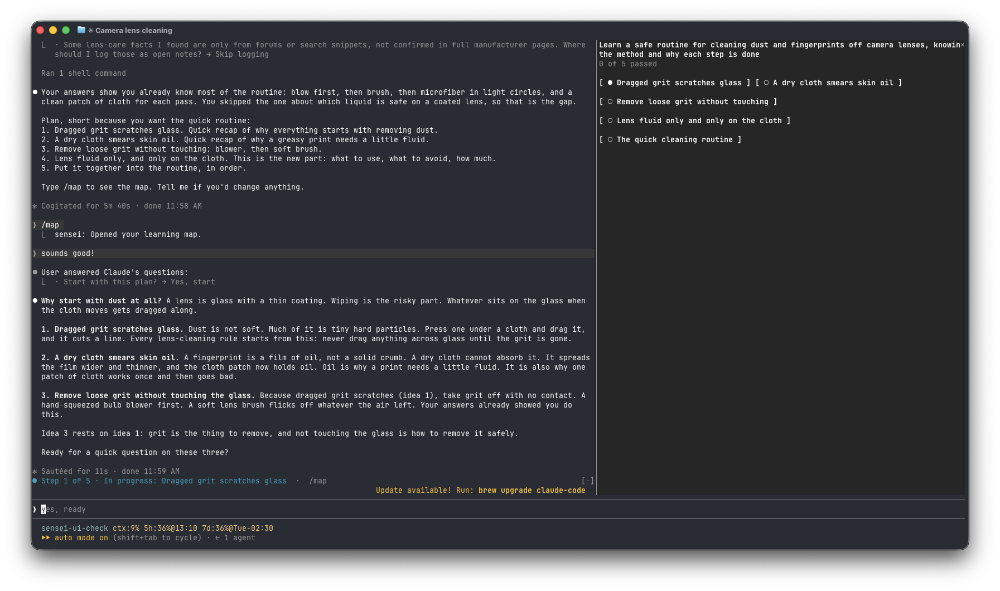
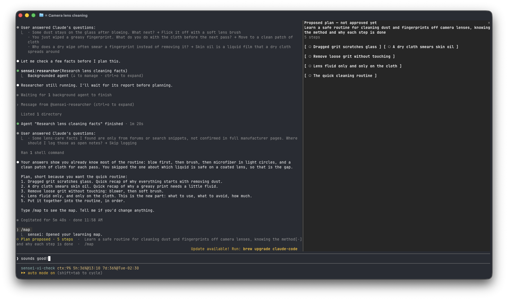
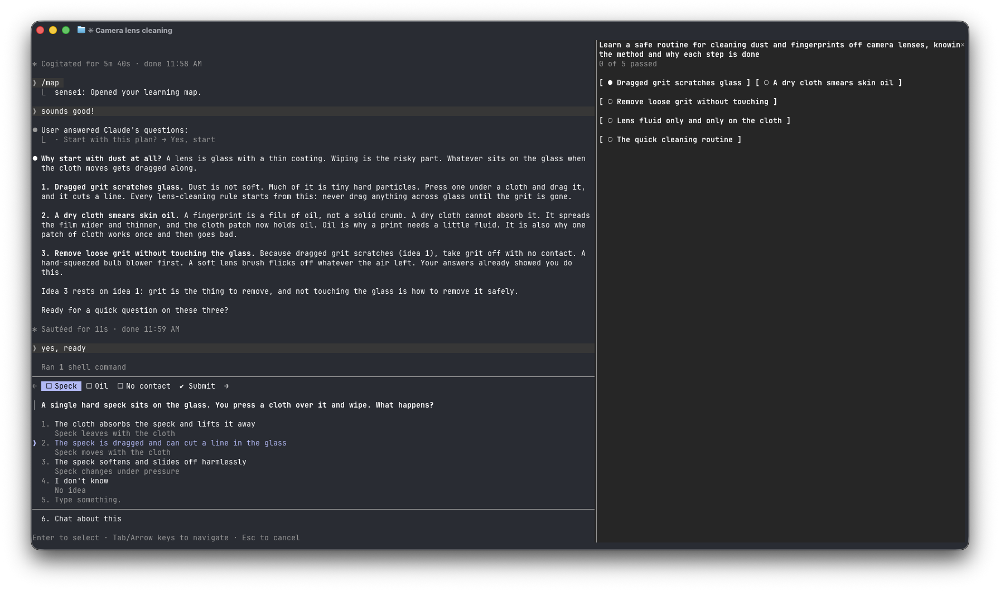
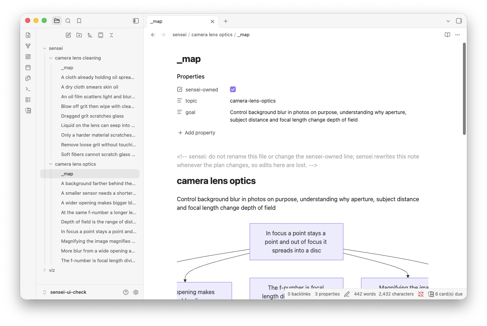

<p align="center"></p>

<h1 align="center">sensei</h1>

<p align="center">Learn anything in Claude Code with a plan you approve of first and a check you pass at each step.</p>

<p align="center">
  <a href="https://github.com/rishichawda/sensei/actions/workflows/ci.yml"></a>
  <a href="https://github.com/rishichawda/sensei/releases"></a>
  <a href="https://github.com/rishichawda/sensei/blob/main/LICENSE"></a>
</p>

<!-- Demo GIF goes here. -->

<p align="center"></p>

An AI explanation can be very clear as you're reading it, and then be completely gone by the next day. Sensei is built around two habits that combat that.

**You see the path before you walk it.** Before teaching sensei asks what you want from the topic, assesses your current level with a few graded questions and then draws up the plan as a dependency map showing what ideas build on what. You either approve the map or make changes to it. It then teaches in that order so nothing is explained before the idea it depends on.

**You prove each step as you go.** After each chunk of the lesson the Sensei will ask a short question. A hook will grade your answer and record it so the outcome is not dependent on what the model says happened. A correct answer sees you move on. A miss gets you a fresh explanation and another go.

<div align="center">
<table>
<tr>
<td width="50%"></td>
<td width="50%"></td>
</tr>
</table>
</div>

**Sensei remembers.** It saves your progress per topic on your machine so when you come back it picks up where you left off and skips the bits you've already done.

## Try it

```bash
claude plugin marketplace add https://github.com/rishichawda/sensei
claude plugin install sensei@rishichawda
```

Start a new session and ask Claude: *"Teach me how DNS resolution works"*.

Other ways to start:

* *"Teach me music theory. I can already read sheet music."* Sensei assesses your level first and skips what you already know.
* *"Teach me how a hash map works and draw how a lookup travels through it."* The lesson includes a diagram.
* *"Continue teaching me DNS resolution."* Sensei picks up the saved session for that topic.

## What you get

**A map you can open.** Type `/map` to get a pane showing the approved plan with one chip per step: ○ not started, ● in progress, ✓ passed, ✗ missed. Click on a chip to see what it builds on and what it builds to. A line appears above the prompt indicating your current position in the lesson and a toast appears for each pass/miss with the number of questions answered correctly. The map is not drawn in the chat.

**Notes in your Obsidian vault.** Set vault path via `/plugin configure sensei` and sensei will save what you learn, one note per concept under `sensei/<topic>/`. The note will contain the explanation, a flashcard for the Spaced Repetition plugin, your answers and how any mistake was re-explained. A `_map.md` note contains the plan as a diagram which Obsidian will draw up for you. The path takes effect on your next message. Concept notes are only ever appended to; sensei only rewrites `_map.md`.

<p align="center"></p>

**Diagrams when they're useful.** A lesson can contain a diagram created by a bundled helper which will check its own output prior to displaying it. Mermaid is used for structure and flow, SVG for geometry and plots. If a diagram can't be generated then the lesson proceeds without it.

## Requirements

* Claude Code 2.1.281 or later. The map pane, the line above the prompt and the toasts need it.
* Optional: [Obsidian](https://obsidian.md) and its Spaced Repetition plugin (for the vault notes and flashcards).
* Sensei is built and tested for Claude Code. In claude.ai chat the lesson and the check questions run, but plugin hooks, agents and the map pane do not load there, so no hook grades or records your answers, no diagram helper runs and there is no map. It has not been tested in Cowork. Use Claude Code for the full experience.

## What sensei runs, stores and sends

**Hooks.** `hooks/hooks.json` runs Node scripts that ship with the plugin, at session start, on each prompt, around each `AskUserQuestion` call, and after `Bash` and `Skill` calls. During a lesson they grade your answer to each check question and record the result, add a reminder for the model when a question is missing its tag or a verdict, and mirror the lesson to your vault if you set one. On a prompt that contains "teach me", "continue teaching" or "resume teaching" they add a reminder to use the `teach` skill. The one hook that runs before a call (on `AskUserQuestion`) can only deny it, to ask for a missing tag; it never approves a call. The hooks read the tool call and result, not the conversation transcript; the transcript's file name is only used to place a small marker file beside it.

**Files it writes.** Under your Claude config directory (`~/.claude`, or `CLAUDE_CONFIG_DIR`), in `sensei/`: one progress ledger per topic in `ledgers/`, a file per running lesson in `active/`, the vault path you set, and two debug logs (`mastery-hook-debug.log`, `vault-debug.log`) that keep the last 200 lines each. They hold topic and step names, the lesson's tag data (which can include the label of the correct option) and error messages, not the text of your questions or your answers. Beside the session transcript: two small marker files ending in `.teach-active-state.json` and `.teach-invoked-state.json`. In your vault, only if you set one: notes under `<vault>/sensei/`. In the current project: rendered diagrams as PNG files in `viz/`. While drawing a Mermaid diagram it also uses a temporary folder, which it deletes afterwards. Sensei writes nowhere else. Delete the `sensei/` folder to remove your progress.

**What it runs.** The diagram helpers run Mermaid CLI and a local copy of Chrome or Chromium to draw Mermaid diagrams, and `@resvg/resvg-js` to draw SVG, on your machine. Claude Code installs these npm packages from the plugin's lockfile when you install the plugin. The mod in `hooks/mod/register.tsx` registers the `/map` command, handles only that command, and draws the map pane, the line above the prompt and the toasts from the ledger files, which it reads once a second. It changes no other call.

**What it sends.** Sensei's own code makes no network requests, has no telemetry and sends nothing to the author. The one network use is the `researcher` agent, which uses Claude Code's `WebSearch` and `WebFetch` tools to ground a lesson in sources. It treats the pages it reads as data, never as instructions.

## Why I built it

One weekend morning, coffee in hand at my desk, I came across a [YouTube video](https://www.youtube.com/watch?v=kzcI5F4tGiU) about using AI and Obsidian to learn anything. I use Obsidian and love picking up new skills, so I wanted a tutor in the tool I already use, one that keeps what I learn in my own notes. The video linked a project, but that was for pi. So I made one myself as a Claude Code plugin. It plans before it teaches, checks before it moves on, and remembers where I stopped.

## Contributing and license

See [CONTRIBUTING.md](CONTRIBUTING.md) and the [code of conduct](CODE_OF_CONDUCT.md). Sensei is released under the [Apache License 2.0](LICENSE).